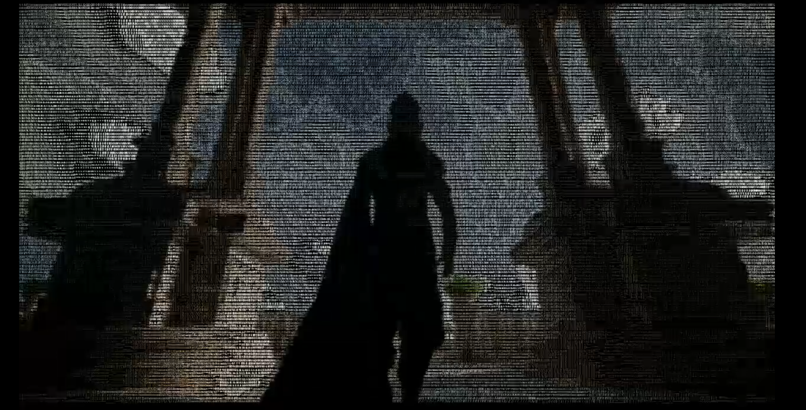
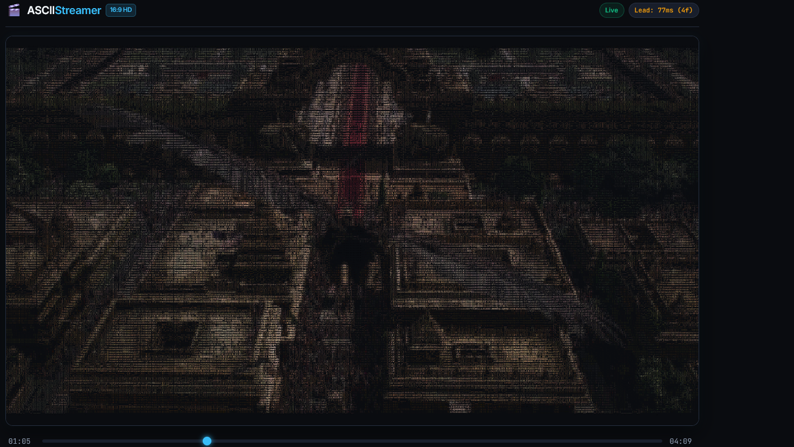

# 🎬 ASCII Video Streamer (Web Edition)

> An ultra-high-performance, real-time Java web application that decodes video files with native FFmpeg hardware scaling, converts frames to ASCII art in a strict **16:9 visual aspect ratio**, streams binary payloads over WebSocket, and exports rendered videos as **MP4 files with original, synchronized audio**.

---

## 📸 Showcase & Preview

<p align="center">
  <table>
    <tr>
      <td width="50%" align="center">
        
        <br><b>1. Real-Time Colored ASCII Playback</b>
      </td>
      <td width="50%" align="center">
        
        <br><b>2. Dynamic 16:9 Size & Preset Controls</b>
      </td>
    </tr>
    <tr>
      <td width="50%" align="center">
        
        <br><b>3. Ultra-HD Resolution (up to 480 Columns)</b>
      </td>
      <td width="50%" align="center">
        
        <br><b>4. MP4 Export with Original Audio Soundtrack</b>
      </td>
    </tr>
  </table>
</p>

> *Tip: You can replace or add your own screenshots inside the [`sample_images/`](sample_images/) folder (`sample_1.png`, `sample_2.png`, `sample_3.png`, `sample_4.png`).*

---

## ✨ Key Features

- **📐 Strict 16:9 Visual Aspect Ratio**:
  - Monospace font characters are typically taller than they are wide ($w_{char} : h_{char} \approx 1 : 2$). The engine applies geometric aspect ratio compensation:
    $$\text{rows} = \text{round}\left(\text{cols} \times \frac{9}{16} \times \text{fontAspect}\right)$$
    so widescreen videos never appear vertically stretched or distorted.
- **🎛️ Dual-Tier Size & Output Controls**:
  - **ASCII Grid Resolution**: Live slider from **48 to 480 columns** with one-click presets:
    - `Compact (80 cols × 23 rows)`
    - `Standard (128 cols × 36 rows)`
    - `HD (160 cols × 45 rows)`
    - `Full HD (240 cols × 68 rows)`
    - `Ultra HD (320 cols × 90 rows)`
    - `Extreme (480 cols × 135 rows)` — *over 64,000 characters per frame!*
  - **Display Zoom & Auto-Fit**: Subpixel font scale slider (`2px`–`28px`) plus an **Auto-Fit** button (or press <kbd>R</kbd>) to automatically fit your browser container.
- **🔊 MP4 Export with Original Synchronized Audio**:
  - Export the ASCII-rendered video into a standalone **H.264 + AAC MP4** video file.
  - Video frames are rasterized and muxed with the source video's original audio track with perfect timestamp synchronization.
  - Live in-browser rendering progress bar and instant automatic download.
- **⚡ Ultra-Fast Server Performance**:
  - **Native FFmpeg Scaling**: `grabber.setImageWidth/Height()` leverages FFmpeg's `libswscale` natively during decoding — zero Java2D software scaling overhead.
  - **Bulk Native Memory Copies**: Uses native `memcpy` chunk transfers, eliminating millions of Java `ByteBuffer.get()` boundary checks per second.
  - **Fast Integer Bit-Shift Luminance**: Computes brightness with pure bit-shift arithmetic `(R * 77 + G * 150 + B * 29) >> 8` for instant auto-vectorized HotSpot execution.
- **🎨 HTML5 Canvas Rendering Optimizations**:
  - **Color-Run Batching**: Aggregates adjacent matching-color cells into single continuous string runs, slashing canvas draw calls by 80–90%.
  - **Row Batching for Monochrome**: Flattens each row to a single draw call (reducing 64,800 draw calls down to 135 calls per frame).
  - **HiDPI / Retina Crispness**: Canvas backing store is scaled by `window.devicePixelRatio`, keeping microscopic 2px font characters razor-sharp.
- **⏱️ Client Timing Authority & Non-Blocking Pacer**:
  - Master clock runs on the browser (`performance.now()`) with a PTS jitter buffer in `requestAnimationFrame`.
  - Non-blocking server pacer self-schedules next ticks and maintains a tight ~400ms lead window.
  - Generation/epoch byte (offset 17) prevents seek-race stale frame flashes.
  - Immutable `Playhead(micros, nanos)` record avoids torn reads during extrapolation.
- **📱 Fully Responsive Design**:
  - Built with CSS `aspect-ratio: 16 / 9`, adapting fluidly between desktop screens and mobile devices.

---

## 🚀 Getting Started

### Prerequisites
- **Java 21 or newer** (Java 25 LTS supported)
- Windows x86_64, Linux, or macOS

### Running the Application

1. **Option A: One-Click Startup Script (Windows)**:
   Double-click `run.bat` or run in PowerShell:
   ```powershell
   .\run.bat
   ```
   *(or `.\run.ps1`)*

2. **Option B: Standalone JAR**:
   ```powershell
   java -jar target\ascii-streamer-1.0.0.jar
   ```

3. Open your browser and navigate to:
   ```
   http://127.0.0.1:8080
   ```
   *(or `http://localhost:8080`)*

---

## 📖 How to Use

### 1. Load a Video
- **Drag & drop** any video file (`.mp4`, `.mkv`, `.mov`, `.webm`, `.avi`) into the 16:9 player area, or click **Choose Video File**.
- The server will probe the file, calculate the native dimensions, and initiate the WebSocket stream.

### 2. Control Playback
- Press **Play / Pause** (or tap <kbd>Space</kbd>).
- Scrub through the timeline with the slider or jump ±5 seconds with <kbd>←</kbd> / <kbd>→</kbd>.
- The stream will seek immediately using native microsecond timestamp positioning.

### 3. Adjust Grid Resolution & Font Size
- Choose from the quick preset chips:
  - **Standard (128)** / **HD (160)** for balanced detail.
  - **Full HD (240)** / **Ultra HD (320)** for fine-grained ASCII fidelity.
  - **Extreme (480)** for high-density ASCII rendering.
- Adjust the **Font Scale** slider, or click **Auto Fit** (shortcut <kbd>R</kbd>) to automatically match your monitor or window size.

### 4. Customize Visual Styles
- **Full RGB Color**: Toggle between full 24-bit RGB and retro monochrome text.
- **Invert Brightness**: Flips dark and light ramps for light or dark terminal backgrounds.
- **Character Ramp**: Select between:
  - `Standard` (` .:-=+*#%@`)
  - `Extended` (70-character density spectrum)
  - `Block Glyphs` (` ░▒▓█`)

### 5. Download / Export MP4 (with Audio)
- Click the green **⬇ Export MP4** button next to the transport controls.
- The server will render the full ASCII video with your selected resolution, colors, and characters, and mux in the **original AAC audio track**.
- Track the live encoding progress modal. Once complete, the `.mp4` file will automatically download to your computer.

---

## ⌨️ Keyboard Shortcuts

| Shortcut | Action |
|---|---|
| <kbd>Space</kbd> | Play / Pause playback |
| <kbd>←</kbd> | Jump backward 5 seconds |
| <kbd>→</kbd> | Jump forward 5 seconds |
| <kbd>F</kbd> | Toggle Fullscreen |
| <kbd>R</kbd> | Auto-Fit canvas to current window |

---

## 📦 Binary Wire Protocol (`ASC1`)

To maximize performance, frames are transmitted over WebSocket as compact binary packets in Big-Endian format:

```
 0               1               2               3
 0 1 2 3 4 5 6 7 0 1 2 3 4 5 6 7 0 1 2 3 4 5 6 7 0 1 2 3 4 5 6 7
+-+-+-+-+-+-+-+-+-+-+-+-+-+-+-+-+-+-+-+-+-+-+-+-+-+-+-+-+-+-+-+-+
|                      Magic: "ASC1"                            |
+-+-+-+-+-+-+-+-+-+-+-+-+-+-+-+-+-+-+-+-+-+-+-+-+-+-+-+-+-+-+-+-+
|                                                               |
+                   Presentation Timestamp (PTS)                +
|                            (Float64)                          |
+-+-+-+-+-+-+-+-+-+-+-+-+-+-+-+-+-+-+-+-+-+-+-+-+-+-+-+-+-+-+-+-+
|         Cols (uint16)         |         Rows (uint16)         |
+-+-+-+-+-+-+-+-+-+-+-+-+-+-+-+-+-+-+-+-+-+-+-+-+-+-+-+-+-+-+-+-+
|  Mode (uint8) |  Gen (uint8)  |   ASCII Chars (cols * rows)   |
+-+-+-+-+-+-+-+-+-+-+-+-+-+-+-+-+                               +
|                              ...                              |
+-+-+-+-+-+-+-+-+-+-+-+-+-+-+-+-+-+-+-+-+-+-+-+-+-+-+-+-+-+-+-+-+
|       Optional RGB Interleaved Bytes (cols * rows * 3)        |
|                              ...                              |
+-+-+-+-+-+-+-+-+-+-+-+-+-+-+-+-+-+-+-+-+-+-+-+-+-+-+-+-+-+-+-+-+
```

| Offset | Field | Type | Description |
|---|---|---|---|
| `0..3` | **Magic** | `char[4]` | Constant `"ASC1"` (`0x41 0x53 0x43 0x31`) |
| `4..11` | **PTS** | `float64` | Presentation timestamp in seconds |
| `12..13`| **Cols** | `uint16` | Grid columns ($N_{cols}$) |
| `14..15`| **Rows** | `uint16` | Grid rows ($N_{rows}$) |
| `16` | **Mode** | `uint8` | `0x00` = Monochrome, `0x01` = RGB Color |
| `17` | **Generation** | `uint8` | Wrapping epoch counter adopted from client seek/resize |
| `18..` | **Char Data** | `uint8[]` | Raw ASCII character bytes ($N = \text{cols} \times \text{rows}$) |
| `18+N..`| **RGB Data** | `uint8[]` | *(Color mode only)* Interleaved raw RGB bytes ($3N$ bytes) |

---

## 🛠️ How to Rebuild the Project

If you make modifications to Java code or web assets:

1. **Using the batch script**:
   ```powershell
   .\build.bat
   ```
   *(or `.\build.ps1`)*

2. **Using Maven directly**:
   ```powershell
   & "$env:USERPROFILE\scoop\apps\maven\current\bin\mvn.cmd" clean package -DskipTests
   ```
   *(or `mvn clean package -DskipTests` if Maven is in your PATH)*

The resulting self-contained executable JAR will be located in `target/ascii-streamer-1.0.0.jar`.

---

## 📂 Project Structure

```
ascii_streamer/
├── sample_images/                          # Showcase screenshots for GitHub README
│   ├── sample_1.png                        # Main ASCII video player
│   ├── sample_2.png                        # Size & preset controls
│   ├── sample_3.png                        # Ultra-HD resolution
│   └── sample_4.png                        # Video export with audio
├── src/
│   └── main/
│       ├── java/com/asciistreamer/
│       │   ├── AsciiStreamerApplication.java
│       │   ├── config/
│       │   │   └── WebSocketConfig.java    # Concurrent WebSocket session wrapper
│       │   ├── controller/
│       │   │   ├── VideoUploadController.java # Multipart upload endpoint
│       │   │   └── ExportController.java   # MP4 rendering & download endpoints
│       │   ├── model/
│       │   │   ├── Playhead.java           # Immutable timestamp record
│       │   │   ├── StreamCommand.java      # Client WebSocket JSON commands
│       │   │   ├── VideoMetadata.java      # Video dimensions & FPS
│       │   │   ├── ExportRequest.java      # Video export options
│       │   │   └── ExportProgress.java     # Live export status
│       │   ├── processing/
│       │   │   ├── VideoDecoder.java       # Native FFmpeg decoder & scaler
│       │   │   ├── AsciiMapper.java        # Bulk memcpy & bit-shift luminance
│       │   │   └── BinaryProtocol.java     # ASC1 packet serializer
│       │   ├── service/
│       │   │   ├── SessionManager.java     # Session lifecycle registry
│       │   │   └── AsciiVideoExporter.java # Background H.264 + AAC MP4 exporter
│       │   └── websocket/
│       │       └── StreamWebSocketHandler.java # Non-blocking WebSocket router
│       └── resources/
│           ├── application.properties      # Port, upload & cache config
│           └── static/
│               ├── index.html              # Responsive 16:9 player UI
│               ├── css/style.css           # Styling & modal overlays
│               └── js/
│                   ├── app.js              # UI controller & export polling
│                   ├── clock.js            # Client timing authority & jitter queue
│                   ├── player.js           # Batched HTML5 Canvas renderer
│                   └── protocol.js         # ASC1 DataView binary parser
├── build.bat                               # Build script for Windows
├── build.ps1                               # Build script for PowerShell
├── run.bat                                 # Startup script for Windows
├── run.ps1                                 # Startup script for PowerShell
├── pom.xml                                 # Maven dependencies & build configuration
└── README.md                               # Project documentation
```

---

## 📄 License

This project is licensed under the [MIT License](LICENSE).
